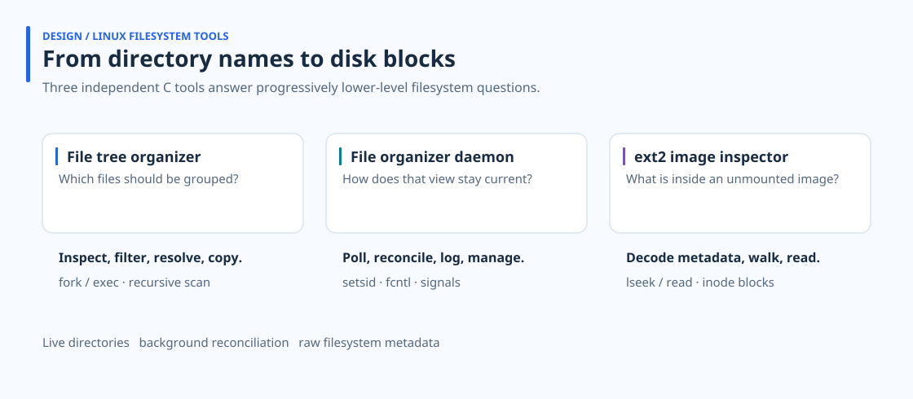

# Linux Filesystem Tools

**How do you turn a directory full of files into a useful view—and keep that view connected to its source?** I built three C tools that approach that question through interactive organization, background reconciliation, and inspection of an unmounted ext2 image.

A folder hierarchy tells you where files were placed, but grouping them by extension introduces a different identity: files from separate folders can now compete for the same destination name. Keeping that grouped view current adds process lifetime, configuration, and deletion rules. Inspecting an image takes away the mounted filesystem interface entirely: names, permissions, and contents have to be recovered from on-disk records.



## File organization: decide what belongs in the destination

The [file tree organizer](https://github.com/jaeunda/file-tree-organizer#readme) combines a recursive directory viewer with a filtered copy operation. `tree` shows names, sizes, and permissions; `arrange` builds an extension index before creating the destination folders. Source files stay in place.

Flattening subdirectories can produce duplicate basenames. I kept that decision visible: the user can select a source, compare or edit the candidates through external tools, or omit the conflicting pair. Extension and subtree filters narrow the selection; the modification-time filter includes files changed within the requested age.

The interactive shell validates the request, encodes worker arguments, and uses `fork`/`execvp` to run the operation in a separate process. The parent waits and returns to its prompt after the worker exits.

In a controlled local measurement, organizing **512 files / 128 MiB took a median 0.122 seconds over five runs**. All 2,560 copies passed SHA-256 verification. This measures complete requests on a warm-cache WSL2 ext4 filesystem; it does not measure durable disk throughput or establish a speedup over another tool. [Fixture, individual timings, and reproduction script](https://github.com/jaeunda/file-tree-organizer/blob/main/docs/measurements.md).

## Background organization: reconcile a derived view

A successful one-time copy becomes stale when the source changes. The [file organizer daemon](https://github.com/jaeunda/file-organizer-daemon#readme) gives each registered directory a detached process that launches a fresh scan worker, waits for it, and sleeps between scans.

Each worker reads the current configuration, builds filename-sorted source and destination lists, then advances two pointers. Source-only entries are copied; destination-only entries are removed; matching names use the configured modification-time policy. The destination is therefore a managed view of the selected files, with deletion propagated from that selection.

I separated the long-lived polling process from the short-lived worker so filters and duplicate policies can be reloaded between scans. Configuration, registration, and copy-log operations use advisory `fcntl` locks. The shell exposes `add`, `modify`, `remove`, and `show`, while daemons continue after the shell exits.

Validation confirmed that a daemon survived shell exit, copied a later file, applied a revised extension filter, and removed its registration. The current daemon retains its original sleep interval, and its SIGTERM path does not wait for an active worker; the detailed README explains those lifecycle limits.

## Image inspection: recover paths from filesystem records

The [ext2 image inspector](https://github.com/jaeunda/ext2-image-inspector#readme) exposes `tree` and `print` without mounting the image or linking an ext2 library. It opens the image read-only and uses locally defined disk structures with `lseek` and `read`.

The superblock supplies filesystem geometry. Group descriptors identify inode tables; directory records connect names to inode numbers. A depth-tagged linked list lets the tree renderer work with recovered names and metadata. File printing follows direct, single-, double-, and triple-indirect pointer paths.

Fresh 1 KiB and 4 KiB block images reproduced recursive trees, permissions, short text, empty files, missing-path errors, and a 480,000-byte text fixture. The image hashes stayed unchanged. Printing remains text-oriented: blank lines disappear and lines crossing block boundaries are split. Directory lookup also has a reproduced prefix-match defect. These tools demonstrate the decoding mechanism rather than full ext2 compatibility.

## Explore and run

| Repository | Main design problem | Executable |
| --- | --- | --- |
| [file-tree-organizer](https://github.com/jaeunda/file-tree-organizer) | Resolve selection and basename collisions before copying | `ssu_cleanup` |
| [file-organizer-daemon](https://github.com/jaeunda/file-organizer-daemon) | Keep an extension-grouped view current across scan processes | `ssu_cleanupd` |
| [ext2-image-inspector](https://github.com/jaeunda/ext2-image-inspector) | Translate image records into directory and text views | `ssu_ext2 IMAGE` |

The projects are independent Git submodules. Use Linux or WSL, Make, and GCC; GCC 13 is the documented compiler for the daemon project. Python 3 is needed only for the organizer benchmark, and `mke2fs` only for creating the inspector's example image.

```bash
git clone --recurse-submodules https://github.com/jaeunda/linux-filesystem-tools.git
cd linux-filesystem-tools/file-tree-organizer
make
./ssu_cleanup
```

For an existing clone, initialize the projects with `git submodule update --init --recursive`. Run each interactive program from its own project directory; the organizer and daemon resolve their worker executables there. Their original executable names remain the command interface.

The detailed READMEs explain the implementation, commands, verified behavior, and remaining limits. [Validation notes](docs/validation.md) record the shared environment and checks. All ten design diagrams from the development reports are included as redesigned SVGs, alongside an overview and an inode-addressing figure. Figures use outlined Noto Sans with the [font license](docs/assets/NotoSans-OFL.txt). Original Word reports and extracted screenshots remain outside the repositories.
